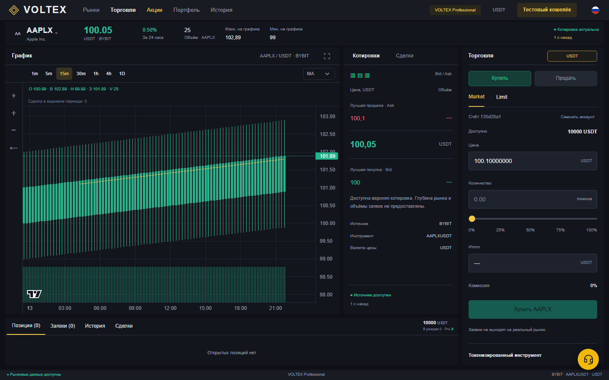
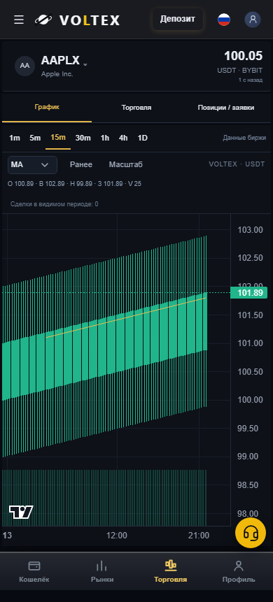

# Stocks localization — retained local frontend evidence

This evidence belongs to PR #512. It is **before the subsequent public-host Wallet-read guard fix**. It must not be presented as final-head CI or evidence that the later host-policy change was already tested. No deployment, merge, production access, real orders or balances were involved.

## Result at this frozen localization source

- Canonical isolated Windows/Node 24.21.0 snapshot: **TypeScript PASS; production build PASS; 255/255 frontend suites and 4,185/4,185 tests PASS**, zero failures, pending or todo tests.
- Browser r6: **662 assertions PASS**, 56 language/width cases (7 languages × 8 widths), 7 actual mounted language switches, zero page errors or unexpected financial writes. External fixture resources were blocked; screenshots use **synthetic local market fixtures**, not live prices or provider-readiness evidence.
- Base Git HEAD: `50b16c1d9e5d07503b84e3d9ac810708847d2a8e`. Canonical source-tree hash: `531602cbfd4342b8bd1cff34362a8c36eb2defb3037ee850ac1eb6843fe95ccf`. The snapshot records 16 frontend overlays and 27 explicitly allowed source/test/QA overlays total; 4,660 captured source files were unchanged after validation.
- The exact compiled Stocks JS and CSS from the canonical snapshot match the browser build: JS `ba0c8b92da5909e4c10e95d203b152b255dd85859fb76f38c69b2b9e6d43f3ff`; CSS `ef2e069aa1ab21ae2134cfb7aced485a6675be4f4979f0126e0b66809dc25e16`.

## Earlier failures are retained

The original Windows run had 4,177 PASS / 8 FAIL. Two actual Stocks regressions were corrected without relaxing tests: a new shared-header selector was replaced by Stocks-owned wrapper stacking, and two English labels used the required product wording. Six other failed checks were caused solely by CRLF checkout bytes in unchanged PriceChart, OrderForm, Academy CSS and the byte-locked Apple Pay SVG. Each exact failing assertion was independently tested against current checkout bytes and canonical Git bytes; all six fail CRLF and pass Git LF. All four files normalize byte-for-byte to the exact Git blobs.

The first attempted Git archive also applied local `core.autocrlf=true`; its six-case FAIL is retained. The second export used **process-local** `git -c core.autocrlf=false -c core.eol=lf archive`. This corrected only the disposable snapshot representation. No Card, Futures, Spot or Academy working file, test, Git setting or threshold was edited.

The successful focused rerun executed the six failing cases; its 124 unselected cases are not full-suite acceptance. The later full run selected every one of the 255 frontend test files, without a test-name filter, and passed all 4,185 cases with zero skips. Original failure JSON, failed archive JSON and complete logs remain here. Logs are losslessly gzipped where large, with compressed and original SHA256 in [manifest.json](manifest.json).

## Snapshot and isolation

The safe extraction rejects traversal, symlinks, duplicate members and unexpected paths. Only Git-tracked HEAD content and the explicit source/test overlay allowlist were copied. No ignored files, actual environment files or database files were copied; even three tracked `.env.example` templates were excluded and recorded. The root and frontend dependency trees are reused through documented junctions, while build output, temporary files and reports are confined to the disposable snapshot. The full source hashes, overlays and dependency targets are in [canonical-source-manifest.json](canonical-source-manifest.json); exact commands and sanitized child environment are in [pre-host-fix-commands.json](pre-host-fix-commands.json).

The new browser assertions use independent seven-language labels. They retain actual form/chart DOM instances and entered values across a context switch, and keep the same pending idempotency key during account-busy recovery. No-extra-request assertions are specifically during hidden/drained or account-paused states; they do not claim normal visible polling ceases. Existing deadline, cooldown, stale-price, retry and financial admission criteria were not loosened. The production build's existing chunk-size warning and all Jest console output are retained.

## Screenshots

Desktop 1440 px and mobile 390 px, before injected overload. These demonstrate layout only; the displayed market/account values are local fixtures.

## Remaining boundary

The subsequent host-policy fix needs its own focused validation and final CI, recorded separately. This local frontend PASS does not clear original Stocks capacity/coexistence failures, data-rights/MOEX restrictions, authentication workload limits or production-integration gates. No production-ready claim is made.
