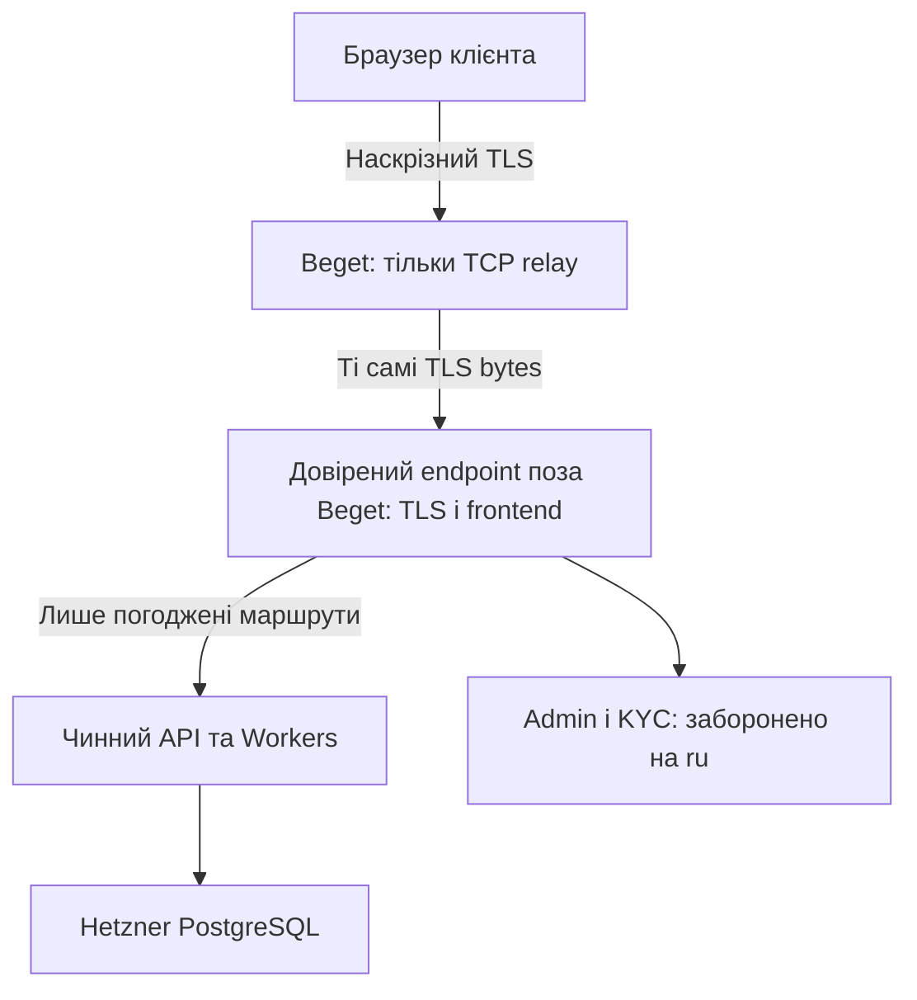

# VOLTEX / Beget: перевірка безпеки та фактичне блокування

Дата: 26.10.2026. Результат: **NO-GO для входу, приватних даних і фінансових
функцій через Beget. SECURITY HOLD фактично застосовано.**
Час доказів наведено в UTC; для Europe/Kyiv цього дня +2 години.

## Що реально перевірено та змінено

- Fresh GitHub main: `63d6b02cd38fe9ff52742c35ce46fa327827dd33`.
- Один VPS `voltex-ru-gateway-01`, Санкт-Петербург, `185.23.35.226`, Ubuntu 24.04.5,
  2 CPU / 1 ГБ / 20 ГБ. Додаткових ресурсів не купували. VPS + IPv4 917.10 ₽/30 днів,
  плюс раніше погоджений Blog 520 ₽/місяць; разом 1437.10 ₽ в 30-денному еквіваленті.
- Власник прийняв умови LE до запуску. Сертифікат тільки `ru.voltextech.net`
  було видано один раз; строк до 24.01.2027. Ключ головного VOLTEX не переносився.
- Перший TLS reload відкотився після передчасного local curl (exit 7).
  Окрема перевірка готовності зафіксувала успіх на другій спробі через 250 мс.
  Потім служба моніторингу отримала PermissionError на `/etc/nginx/voltex-rf/access.log`
  (каталог 0700 через umask); відбувся другий автоматичний відкат. Помилки збережені.
- До нового наказу повний L7-конфіг коротко завантажувався для local health.
  Не стверджуємо, що він ніколи не був увімкнений. Власні тести не передавали
  користувацьких/адміністративних сесій, KYC або фінансових запитів. Журнал навмисно
  не містить URL/токенів; він не доводить відсутність усього стороннього трафіку.
- О 18:31:27 UTC застосовано окремий security hold на Beget. `nginx -t` PASS;
  Nginx active, 443 відсутній до і після, усі 9 перевірених HTTP-шляхів = 503.
  Немає upstream, frontend, JS, форми входу, адміністративних, KYC чи фінансових API.
  ACME challenge також 503. Старі monitor/certbot timers disabled, exit 0.
  Старі сценарії активації перейменовані `.disabled`, root marker залишено.
- SHA256 активного Nginx: `2545647149b5155affb8a8b839767a0e8444a8dbe2674ed9d2982db5ade184f5`.
  Він дорівнює checked-in `ops/beget-rf/nginx.conf` і `security_hold.CONFIG`.
- О 18:33 UTC зовнішні RF-точки Томськ AS31357 та Москва AS16262 отримали 503
  на `/api/v1/admin/users` з правильною maintenance-відповіддю. Це перевірка
  закриття, **не** підтвердження роботи біржі/всіх домашніх чи мобільних мереж РФ.
- Локальний справжній браузер також показав maintenance через HTTP до вилучення DNS.
- Після виявлення ризику чинного ru-ключа на Beget вилучено **лише ru A**.
  Додано **ru CAA 0 issue ";"**, DNS-only, TTL Auto; публічно 300 секунд.
  Public DoH о 18:47:59 UTC: ru A/AAAA без адрес, ru CAA = deny issuance;
  NS Lana/Thomas Cloudflare збережені. AD=false у цій відповіді; DNSSEC не підтверджено.
  Негативний DNS TTL у відповіді 1800; майбутнє відновлення потребує врахувати кеші.
- Основна сторінка реально відкрилася в браузері на 1440 і 390 px.
  API `/health` відповів status ok, deployed SHA
  `89c3ac003b44a6a0e7630d2ecbe5d7164e85b683`, startedAt 23.10.2026 16:30:08 UTC.
  Це перевірка доступності home/health, не новий фінансовий regression suite.
- Hetzner, PostgreSQL, balances, orders, API/Worker configuration, основний frontend,
  торгові прапорці, TYVN/ECLAVO та інші лістинги не змінювалися. Merge/deploy не було.

## Поточні маршрути

| Маршрут | Фактичний результат | Хто бачить вміст |
| --- | --- | --- |
| Browser → ru DNS | A/AAAA відсутні | DNS-провайдер бачить DNS-метадані |
| Прямий Beget IP:443 / старий DNS cache | Немає TLS listener | Обмін застосунку не встановлюється |
| Beget IP:80 з Host ru, будь-який URL | 503 plain text, CSP default-src none, no-store | Beget бачить HTTP URL/метадані такого запиту; приватних функцій немає |
| `/admin`, `/api/v1/admin/users` | 503 на вузлі; немає upstream | Не йде в адміністративний API |
| `/api/v1/deposit-address/ETH`, `/api/v1/withdrawals` | 503; немає upstream | Не отримує адрес/балансів, не проводить операцій |
| `/_voltex/kyc/v1/submit`, login, assets | 503; немає upstream/JS | Немає форми для введення документів/пароля |
| Browser → основний VOLTEX → існуючий Cloudflare/API | Чинний довірений маршрут | Існуючі довірені TLS endpoints; Beget не бере участі |

Під час DNS propagation кешовані адреси можуть зберігатися. Саме тому одночасно
залишено закритий listener/config, а не лише змінено DNS.

## Чому попередня L7-архітектура неприйнятна

Було заплановано Browser TLS → **Beget TLS termination** → новий TLS →
Cloudflare frontend/API/Workers → Hetzner API/PG. На Beget Nginx, root/гіпервізор
технічно мають доступ до розшифрованих заголовків і тіл, навіть при no-store,
відсутності логів і TLS до upstream. Секрети в RAM теж доступні адміністратору вузла.
Plain HTTP між Nginx і локальними компонентами не потрібний для цієї атаки:
розшифрування вже відбулося всередині процесу Nginx.

У вихідному render.py був catch-all `/api/v1/` з Authorization та окремий KYC
proxy. Отже адміністративний API не був відсічений, баланси й паспорти могли б
проходити через вузол. Public/frontend paths прибирали credentials, але це не
запобігало зміні HTML/JavaScript, фішингу або перехопленню наступного входу.

`frontend/src/lib/api.ts` зберігає `exchange_token` у localStorage і додає Bearer
у запити. LocalStorage ізольований між origin, тому автоматичне читання токена
головного origin з ru не передбачене. Однак JS, який ru віддає при вході на ru,
може читати власний токен, введений пароль, підміняти форми/адреси та надсилати
дозволені запити. Не переносили токен із головного origin і не входили в admin на ru.

CORS, CSP, HttpOnly cookie, no-store, прихований API URL, WAF або SRI окремого JS
не усувають контроль зловмисного root над документом. Він може змінити сам HTML,
CSP/SRI або UI. Перехід до cookie сам по собі не вирішив би підміну сторінки.

## Адреси депозитів

Перевірені на цьому SHA шляхи:
`frontend/src/lib/api.ts:getDepositAddress`, `frontend/src/lib/depositCatalogue.ts`,
`src/api/routes/deposits.ts:/deposit-address/:chain`.
Браузер отримує JSON адреси/каталогу через HTTPS; у перевірених клієнтських шляхах
немає незалежної криптографічної перевірки підпису адреси довіреним зовнішнім UI.
ETag, revision, If-Match, перевірка форми адреси чи журнал копіювання не є таким
захистом. Не стверджуємо, що перевірили кожну фінансову підсистему.

Навіть підпис API-відповіді не захищає, якщо той самий недовірений вузол може
замінити JS-перевірку, DOM, QR або clipboard. Адреса повинна рендеритися з UI,
автентичність якого забезпечує TLS довіреного endpoint поза Beget. За потреби
додатковий підпис перевіряється саме цим довіреним клієнтом/незалежним каналом,
з прив'язкою asset, network, address, memo, version/expiry. Фінансовий код не змінювався.

## Підготовлена архітектура без розшифрування на Beget

Це **пропозиція, не production-конфігурація**. Довірений endpoint не визначений
і не створений. Код вимагає явно вказати окремий перевірений IP; Beget IP, private,
loopback у production і довільні hostname не приймає. Жодного passthrough у
production не застосовано.

| Дані | Beget за коректного end-to-end TLS | Довірений endpoint |
| --- | --- | --- |
| Client IP, час, обсяг/довжини пакетів, destination IP | Доступні; не обіцяємо анонімність | Також доступні |
| SNI/ALPN ClientHello без ECH | Можуть бути видимі | TLS server |
| HTTP URL/headers, session token, JSON, JS/body | Непрозорі за нормальної перевірки TLS і захищеного issuance | Розшифровує, тому входить до trust boundary |
| Admin/KYC | Relay не вміє відсікти HTTP path | Має відхиляти до API; адміністратор входить лише через основний довірений origin |
| PG, signing/DNS credentials, основний TLS key | Не передаються та не зберігаються на relay | Лише вже довірені компоненти за потребою |

Технічні обмеження:

1. `ssl_preread` читає ClientHello без завершення TLS; на Beget не повинно бути
   `listen ... ssl`, `ssl_certificate`, HTTP URL rewrite чи frontend response.
2. SNI зберігається `ru.voltextech.net`. Заміна SNI на `voltextech.net` зі збереженням
   браузерного TLS неможлива звичайним TCP relay; кінцевий сервер має обслужити ru
   з валідним ru-сертифікатом. Не достатньо навмання переслати на Pages або API IP.
3. Admin/API/KYC path filtering можливий лише на довіреному L7 endpoint.
   Потрібні default deny, нормалізація encoded/duplicate-slash path, Host/Origin,
   upstream allowlist, відсутність обходу catch-all та відмова admin-сесій на ru.
4. Origin/localStorage лишаються ru. API CORS/session, logout/revocation і client-IP
   chain ще треба окремо перевірити без послаблення захисту й фінансових записів.
5. WebSocket/SSE можуть проходити як TLS bytes; перевірка саме цих production
   потоків не виконана. TCP-relay не передає HTTP/3 UDP; потрібний коректний H2/H1
   fallback без чужого Alt-Svc, що веде браузер напряму до недоступного endpoint.
6. ECH може приховати потрібне SNI; unknown/no SNI fail closed у proposal.
   Не вмикали/не вимикали ECH у production. DPI/SNI/IP blocking і доступність
   Beget → trusted endpoint залишаються окремими RF-перевірками.
7. Beget/root все ще може відмовити в обслуговуванні та бачити метадані.
   Не може непомітно змінити TLS-вміст без придатного ключа/сертифіката або
   порушення PKI/client trust. Абсолютну гарантію проти всіх CA/OS атак не заявляємо.

## Ключі та випуск сертифікатів — залишковий блокер

На Beget залишилися неактивні ru-only key/certificate та ACME account; їхні приватні
байти не читалися/не експортувалися. LE live inventory містить тільки ru.
Окремий сертифікат головного VOLTEX цією роботою не встановлювався.

CAA deny не відкликає чинний сертифікат. Перш ніж знову направляти ru на Beget:
потрібне відкликання старого ru-сертифіката, новий незалежний private key на
довіреному endpoint, оцінка кешів/перевірки revocation у клієнтах. Видалення файлу
з VPS не доводить відсутності копій у провайдера. Revocation також не є миттєвою
універсальною гарантією для всіх браузерів.

Далі issuance тільки DNS-01 з управлінням поза Beget; обмежити ru CAA на обраний
CA, validationmethods=dns-01 та конкретний ACME account, якщо CA підтримує.
На Beget не передавати Cloudflare API token, ACME account key довіреного CA,
wallet/private/signing key чи server session secret. Поточний CAA deny залишати
до погодженої підготовки довіреного endpoint. Основний CAA/SSL не змінювати.

## Правила провайдера й персональні дані

Перевірено офіційні джерела 26.10.2026:

- https://beget.com/ru/cloud-rules-ru : заборона масових VPN/proxy, а в обмеженнях
  VPS також згадуються proxy-сервіси/аналогічні рішення. Є вимоги законності
  обробки чужих даних і належних дозволів для регульованої діяльності.
  Власний fixed-target web gateway не є відкритим проксі, але автоматичний
  виняток із цих умов **не доведений**. Не отримували дозволу від провайдера,
  не писали підтримці й не обходили обмеження.
- https://beget.com/ru/full-offer-text : управління VPS на стороні замовника;
  сам факт оплати не підтверджує дозволеність конкретної архітектури.
- https://beget.com/files/personal-data.pdf : політика Beget від 04.05.2026
  описує обробку даних його клієнтів. Це не доказ укладеного DPA/доручення щодо
  паспортів, balances чи клієнтів VOLTEX.
- https://www.kremlin.ru/acts/bank/24154 — 152-ФЗ; предмети обов'язкової окремої
  перевірки: підстава/доручення обробки, конфіденційність/безпека, локалізація
  первинного збору громадян РФ (ст.18(5)), транскордонна передача (ст.12),
  повідомлення оператора (ст.22). Офіційний full text тайм-аутнув; пошук знайшов
  офіційні сторінки/поправку 23-ФЗ від 28.02.2025, але це не legal clearance.
- https://pd.rkn.gov.ru/cross-border-transmission/form2/ : офіційний пошуковий
  результат підтверджує окреме попереднє повідомлення щодо транскордонної передачі;
  відкриття форми тайм-аутнуло. Не подавали документів і не заявляємо compliance.

TLS passthrough не робить IP-метадані автоматично анонімними і не вирішує сам
по собі питання юрисдикції, localization, KYC/біометрії, privacy notices, ролей
оператора/процесора або законності доступу до crypto-сервісу з РФ. Статус/юрисдикція
юрособи VOLTEX та потрібні правові підстави тут не встановлені. Не переносимо PG
у РФ і не заявляємо, що один Beget VPS задовольняє законодавчі вимоги.

## Фактично запущені вузькі перевірки

- `security-tests.txt`: **7/7 PASS**, Nginx 1.30.6 stream/preread, loopback,
  синтетичний клієнт, незалежний тестовий TLS endpoint, без production traffic.
  Збіг fingerprint кінцевого сертифіката й exact body bytes; у relay немає ключа;
  чужий/відсутній SNI закривається; недовірений сертифікат відхиляється.
  Admin=403 доведений тільки на тестовому довіреному endpoint, не на майбутньому production.
- RenderTest **5/5 PASS**: production/default/old bootstrap віддають лише hold,
  parity checked-in config, invalid inputs, розділені legacy market/API prefixes.
- Python compile PASS. Активний Ubuntu Nginx 1.24 `nginx -t` PASS.
- Перша local stream підготовка була FAIL: старий binary/конфіг збірки не мав
  працездатної stream-конфігурації. Окремий чистий builddir усунув помилки feature
  detection/linking. Початковий multiprocess fixture мав handshake timeout;
  single-process loopback fixture та bounded server socket зробили перевірку
  відтворюваною. Timeout не приймається як PASS для SNI rejection. Старі помилки
  збережені в security-tests-initial.txt / security-tests-stream-initial.txt.
- Старі 17/17 L7 transport tests були пройдені до нової вимоги; це **не** security
  acceptance нового trust boundary. Повний набір повторно не запускався.
- Немає нового PG/Docker/Prisma/50+2, загального CI чи фінансових операцій.

## Точні наступні кроки, без запуску фінансових функцій

1. Залишити ru без A/AAAA та Beget у hold. Попередній L7 proxy не є rollback-кандидатом.
2. Закрити provider-policy і застосовні правові підстави; без обходу заборон.
3. Погодити конкретне наявне довірене місце TLS termination поза Beget без зміни
   production Hetzner/API/PG. Платні сервери не створювалися; такого endpoint наразі немає.
4. Підготувати trusted frontend/route allowlist і deny admin/KYC/finance; прив'язати
   ru hostname, незалежний key/сертифікат, DNS-01/CAA. Прибрати ризик старого ru key.
5. Ізольовано перевірити TLS/certificate substitution, HTML/JS tampering, адреси/QR,
   cookies/Origin/CSRF, logout/revocation, user/admin separation, encoded-path bypass,
   upstream TLS, WS/SSE/H2, no private logs/cache та IP-chain без послаблення захисту.
6. Лише після доказів і окремого погодженого контрольованого ввімкнення — RF probes
   та реальні домашня/мобільна мережі без VPN; спочатку без фінансових дій.

**Не оголошено робочий російський вхід. Фінансовий запуск через Beget заблоковано.**

## Походження виконаних сценаріїв

`executed/*.py.txt` — точні несекретні версії, передані на власний VPS до нового
security order; вони збережені як текст для перевірки походження. Чинні ops-версії
цих activators тепер блокуються до будь-яких дій. Старий текст не є дозволом
виконувати його знову. SHA original activation збігається з server result;
original stage1 transfer = 3af9ae6372d9bbcebf8ba1addf23c4f6d13a06b514e151473d0d38a94c2847cb.
