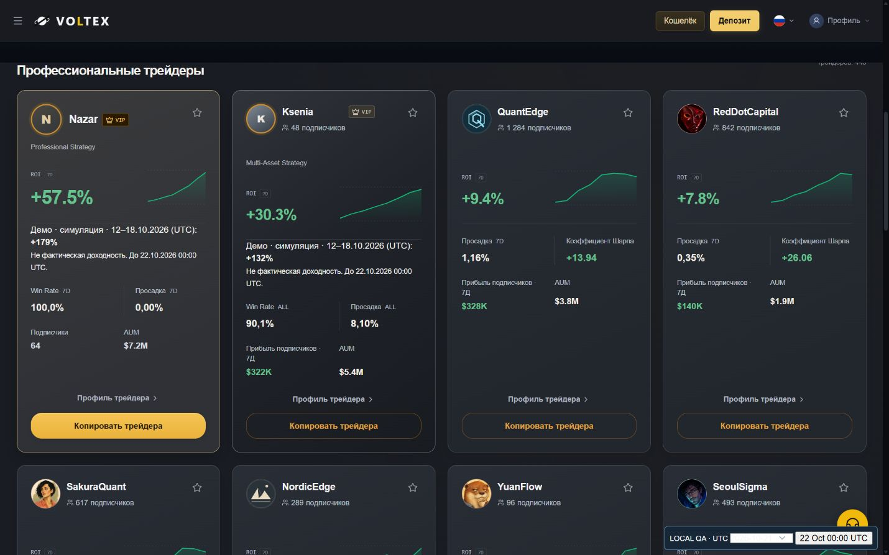
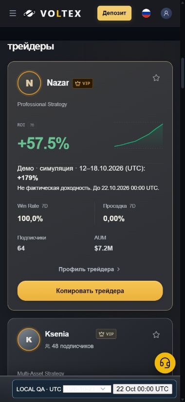
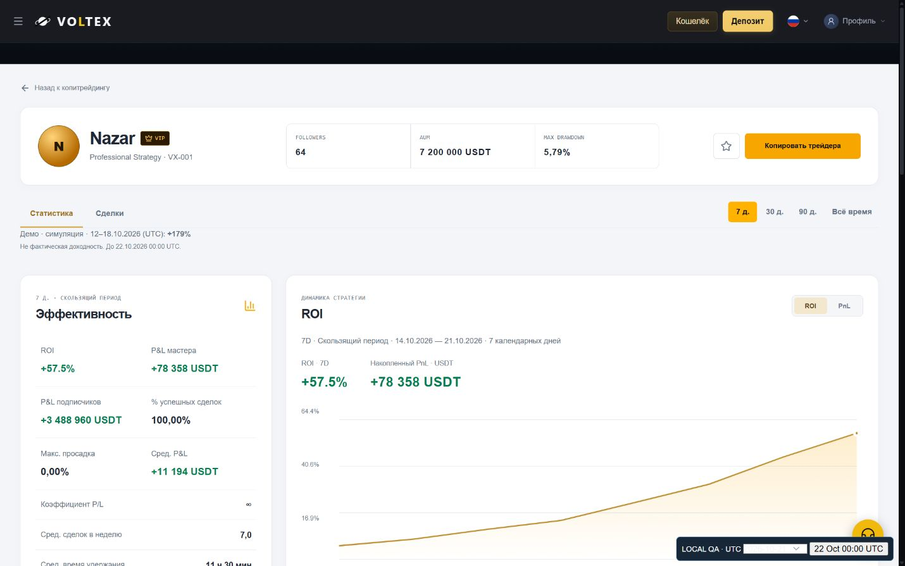
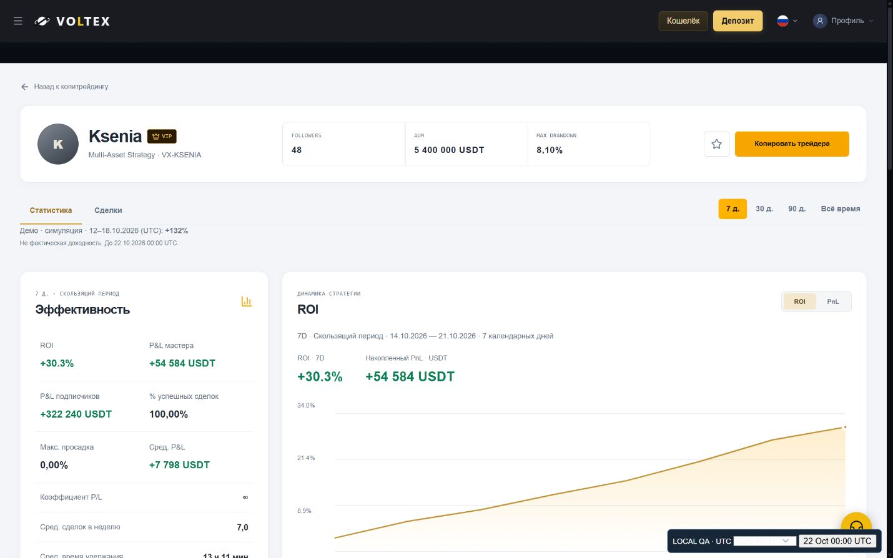
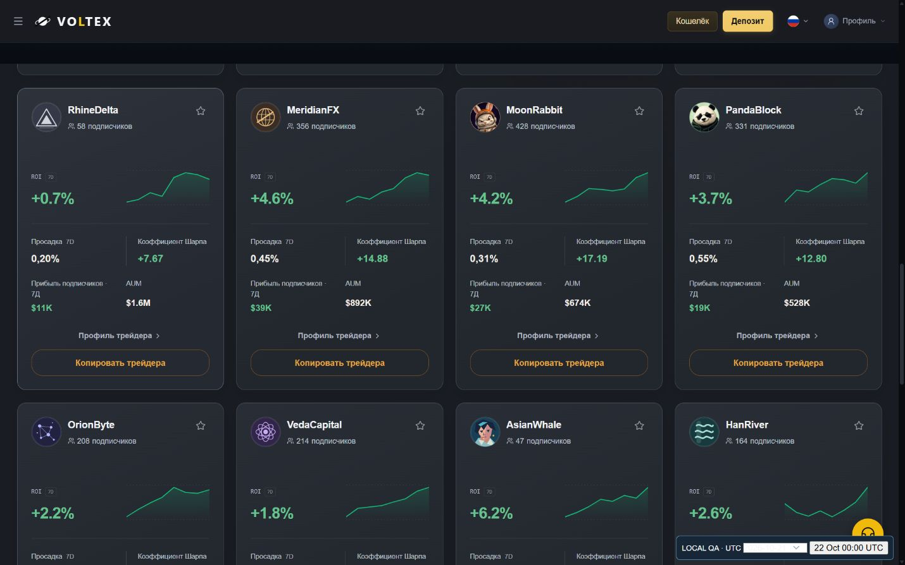
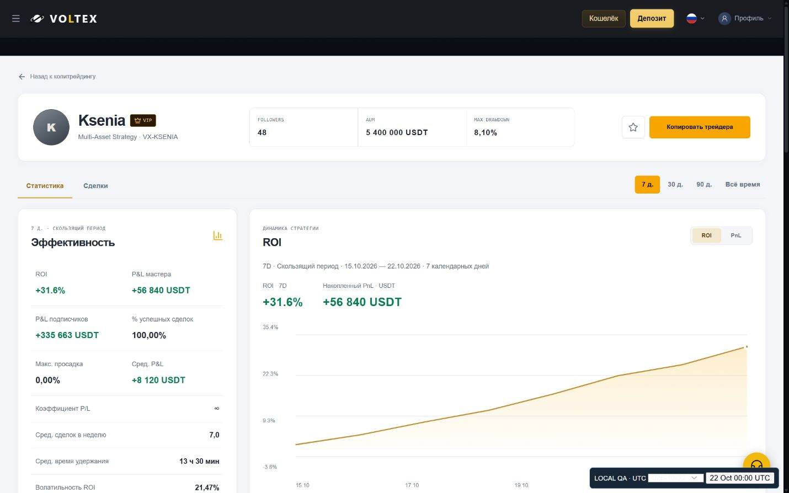

# Copy Trading: dated demo, static catalogue and stable avatars

Review only. No merge, deploy, production migration or financial data modification.
Fresh base: `2e7acf158000404133db85723bac13695215e25c` (origin/main, 17 October 2026).

## Result

- Nazar VX-001 +179% and Ksenia VX-KSENIA +132% are separate, explicitly simulated labels for 12–18 October 2026 (UTC). They never replace rolling ROI, P&L, chart points or API/cache payloads. Only matching MODELED / SYNTHETIC_REVIEW provenance enables the label. No label for real/unknown data or other periods/traders.
- The display-only deadline is 22 October 2026 00:00 UTC, exclusive. A boundary timer and focus/visibility refresh remove it without an API response or page reload. Mounting after the deadline does not recreate it. Ordinary dynamic statistics keep running throughout.
- The 30 ordinary catalogue traders retain their original numbers. Follower-profit offsets are frozen to 17 October 2026 instead of advancing daily. A SHA-256 baseline of all 120 original trader/period values verifies exact preservation: `d9c7661f2975fe25cd031d5d34693d072e93d1cf5d9d2d7a662a8e4a4d2078e5`.
- QuantEdge, MeridianFX, VedaCapital and NexaTrade have stable original vector emblems. Existing photos/mascots are retained. The 432 invitation-only aliases receive unique stable mark/palette combinations; access restrictions and absence of financial data remain intact. No card layout or CSS redesign, no changes to featured avatars.

## Dynamic/static audit

| Surface | Behavior |
| --- | --- |
| Nazar / Ksenia history | Existing daily modeled engine; one closed trade per UTC day, persisted and idempotent. |
| ROI, P&L, follower P&L, curves, Win Rate, Drawdown | Recomputed for 7D/30D/90D/ALL from existing history. Win Rate and Drawdown may legitimately stay equal on consecutive days. |
| Featured AUM / copiers | Existing scenario allocation values (Nazar 7.2m / 64; Ksenia 5.4m / 48), unchanged across this fixture window; they are not random daily counters. |
| Ksenia card Win Rate / Drawdown | Existing explicit ALL labels, intentionally different from a profile's selected 7D. |
| Other 30 catalogue traders | ROI, Win Rate, Drawdown, AUM, copier counts and demo curves are static. Follower profit and derived trader earnings now also static for each period. |
| Locked directory | Identity/art only; no fabricated financial metrics. |

The removed old 30-second ROI growth remains absent. No new profit-generation mechanism was added.

## Bounded five-day test

The real Express router, CopyPerformanceService, MarketplaceSnapshots and frontend CopyMarketplaceStore run against an isolated in-memory persistence adapter. Same store refreshed on consecutive UTC days; no reload needed. All four periods are compared with the ledger and chart endpoint. Original trades remain unchanged, repeat reads add no duplicate, and a new service/snapshot instance restores identical persisted data. Financial write spies are never called. This is a restart simulation, not a production restart.

| UTC date | Nazar rolling 7D | Ksenia rolling 7D | Nazar / Ksenia closed trades | Separate demo |
| --- | ---: | ---: | --- | --- |
| 18 October | 33.218568% | 28.991860% | 521 / 493 | +179% / +132% |
| 19 October | 38.922124% | 28.696716% | 522 / 494 | +179% / +132% |
| 20 October | 50.047537% | 31.230210% | 523 / 495 | +179% / +132% |
| 21 October | 57.493179% | 30.324463% | 524 / 496 | +179% / +132% |
| 22 October | 51.134446% | 31.577995% | 525 / 497 | absent |

These are local modeled fixture results, not verified real trading returns. Full compact measurements: [daily-audit.json](daily-audit.json).

## Validation

- 82/82 tests across 8 targeted suites, final combined run: copyDemoRoi, copyCatalogueStatic, copyPerformancePeriods, traderVisuals, copyCustomerFacingWording, copyTradingCiCoverage, copyHiddenTradeHistory, copyOctoberDemo.
- Seven languages rendered and checked in the actual page component tests: ru/en/zh/es/hi/ja/ko.
- Frontend TypeScript + Vite build PASS. Existing warning: main bundle exceeds 500 kB (600.56 kB); no build error.
- `node --check scripts/serve-copy-demo-review.cjs` and `git diff --check` PASS.
- Browser review at desktop 1440x900 and mobile 390x844. Demo kept separate from current ROI; no mobile horizontal overflow observed. Deadline transition checked in browser without reload.
- Production inspected read-only on 17 October: Nazar rolling 7D +28.3%, Ksenia +30.6%; Nazar latest trade dated 17 October. No production write/restart/future-date simulation or claim of production deployment. User's original 90D marketplace view restored.

Reproduce the integration fixtures by setting `COPY_DEMO_EVIDENCE_DIR` to a local output directory and running the copyOctoberDemo test. Build frontend, then run `node scripts/serve-copy-demo-review.cjs` with the same environment variable. The helper binds loopback only, uses local fixtures/fake time, and blocks external browser connections. It clears only its own local review origin's storage. Never point it at production.

## Screenshots (local fixtures)

