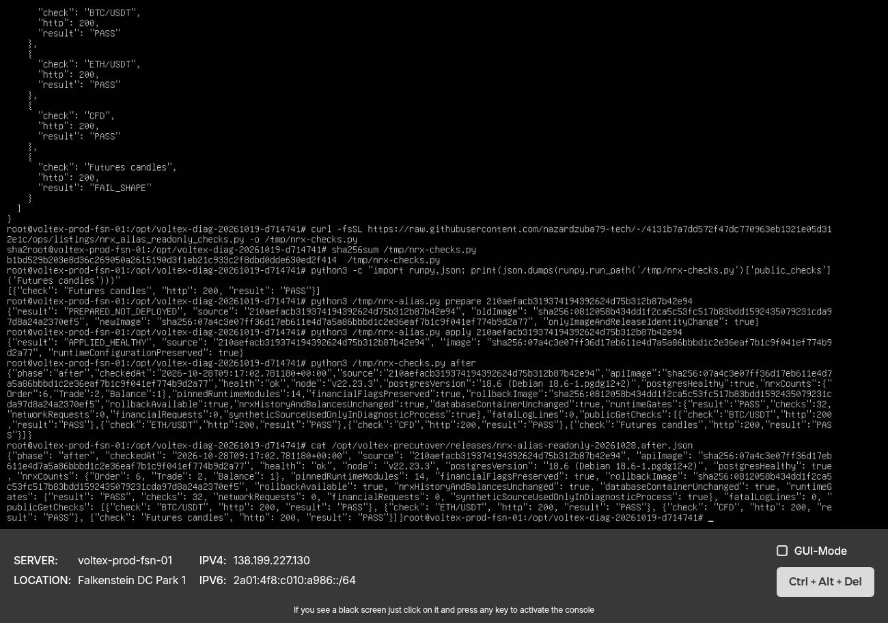
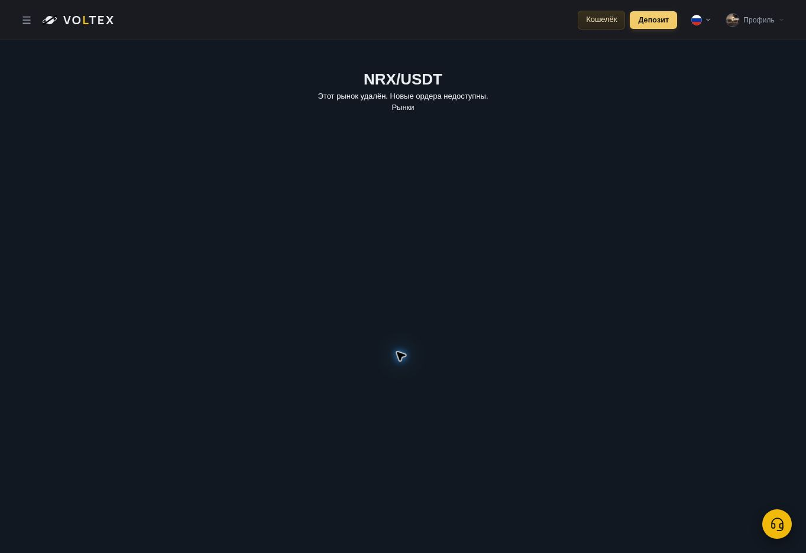

# NRX alias guard — actual production completion, 2026-10-28

This supersedes the earlier terminal-access BLOCKED report. Hetzner authentication and root VNC access were restored through the secure authentication flow. No credentials or personal data are included here.

## Actual release

- Repository main/#637 merge: `57c7592f7c87287d9a080d09b06aec5301b10bb9` (freshly verified; existing CI success, deployment skipped).
- Approved and actually deployed API source: `210aefacb319374194392624d75b312b87b42e94`.
- Previous production API source / rollback: `85f6122b7ac0aa3ce72a2af9ac9aac13d814e44d`.
- Server: existing `voltex-prod-fsn-01`; only `api-production` recreated. PostgreSQL container unchanged.
- Guarded operator SHA256: `dae22b3f97547ab39005c71114854fc0818c911eba607ec73373ba03c264d822`.
- Operator prepare returned `PREPARED_NOT_DEPLOYED`, then apply returned `APPLIED_HEALTHY` and `runtimeConfigurationPreserved:true`.
- Payload: existing-base Dockerfile plus `dist/shared/nrxRetirement.js` and its source map. No broad main deployment.
- Compiled guard SHA256: `2bf120f248775595d3160017e0bcaf6cc160561beeee8b4071fd8e0d249eea7c`.
- Pages remained `f8805b0073d17c3072f37803cb7efbce538ab170`, canonical deployment `ec6734c9-6c1e-4985-8d57-023edc505e9d`; auto production off, previews none. No Cloudflare write.

## Actual server checks

Saved after receipt timestamp: **2026-10-28 09:17:02 UTC / 11:17:02 Kyiv**.

| Check | Actual result |
| --- | --- |
| API health / source | healthy, 210aefac |
| Node / PostgreSQL | v22.23.3 / 18.6 (Debian 18.6-1.pgdg12+2), healthy |
| Pinned runtime modules | 14 hashes checked; only approved shared module changes |
| NRX runtime gates | 32 PASS, zero network/financial requests |
| BTC/USDT / ETH/USDT GET | HTTP 200, positive valid tickers, PASS |
| CFD GET | HTTP 200, positive quotes, PASS |
| Futures candles GET | HTTP 200, existing Bybit V5 category/symbol/OHLC contract, PASS |
| NRX historical data | Order 6, Trade 2, Balance 1; row fingerprints identical before/after |
| Database identity / runtime configuration | unchanged |
| Financial flags / existing P0 fence modules | preserved |
| Checked fatal log lines | 0 |
| Rollback | immutable previous API image and full Compose retained; not used |

The 32 checks executed actual deployed modules in a separate diagnostic Node process. Nine NRX spellings tested: `NRX/USDT`, `NRX-USDT`, `nrx_usdt`, `NRXUSDT`, `NRX`, `NRX/BTC`, `BTC/NRX`, `NRX/SIMUSDT`, `NRXSIMUSDT`. The retirement predicate and both deployed listing gates rejected all nine before IO. BTC/USDT, ETH/USDT and NRXCOIN/USDT remained permitted; synthetic price-source fixtures were confined to that child diagnostic process.

No real financial HTTP request, order, transfer or withdrawal was submitted. Preservation of financial fences is a hash/configuration check, not a claim that a real withdrawal was attempted.

The first pre-release Futures probe returned HTTP 200 but FAIL_SHAPE because the diagnostic assumed the wrong response envelope. Only the read-only probe was corrected to the unchanged FuturesChartCandles/Bybit V5 contract in `4131b7a7dd572f47dc770963eb1321e05d312e1c`; targeted preflight and post-release checks then passed. No application/Futures code changed for this.

## Backup and rollback

- Existing backup service: Result=success, ExecMainStatus=0, exit 2026-10-28 03:22:26 UTC.
- Latest verified snapshot: `/opt/voltex-precutover/backups/local-20261028T032048Z`.
- `database.dump.enc`: 255956442 bytes; SHA256 `464c896c193baeb46f0864a1b6ff72d5d6b257c9b8a0d13046a488554f741eb8`.
- Completion marker and manifest present. No decryption or restore performed; current-backup restore is not claimed.
- Actual old API immutable image retained: `sha256:0812058b434dd1f2ca5c53fc517b83bdd1592435079231cda97d8a24a2370ef5`.
- Rollback remains the guarded operator's previous-image/full-Compose path. No database rollback required by this one-module release.

## Authenticated production browser checks

- Canonical NRX/USDT: removed-market notice; zero canvases, zero inputs; no order panel.
- Direct NRX/BTC URL: same removed-market notice, zero canvases/inputs. Heading normalizes to NRX/USDT; the route remains blocked.
- Markets search NRX: “Ничего не найдено”.
- Spot market drawer search NRX: “Ничего не найдено”, zero visible NRX pair buttons.
- Ordinary BTC terminal: quote present and 11 chart canvases rendered.
- Public Markets still displays QVTR date 28.10.2026 13:00 UTC/16:00 MSK and ECLV 06.11.2026 13:00 UTC/16:00 MSK. No admin mutation or timer command.
- Screenshots captured at the actual desktop viewport; mobile/browser execution of every alias was not performed and is not claimed. All requested aliases were covered by actual server runtime gates.

## Evidence and boundaries

- Host receipts: `/opt/voltex-precutover/releases/nrx-alias-readonly-20261028.before.json`, `...after.json`.
- Guarded release: `/opt/voltex-precutover/releases/nrx-alias-guard-210aefacb319.prepared/`.
- Private state/fingerprints remain mode 0600 on server and are not published.
- Read-only helper: `ops/listings/nrx_alias_readonly_checks.py`, SHA256 `b1bd529b203e8d36c269050a2615190d3f1eb21c933c2f8dbd0dde630ed2f414`.
- No broad CI reruns, new PR, DNS/Worker writes, financial flag change, migration, database write, financial operation, volume cleanup, listing or timer modification.

**Result: approved NRX alternate-pair production patch APPLIED_HEALTHY; targeted actual runtime and browser checks PASS.**
