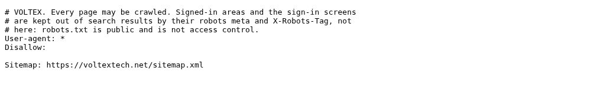
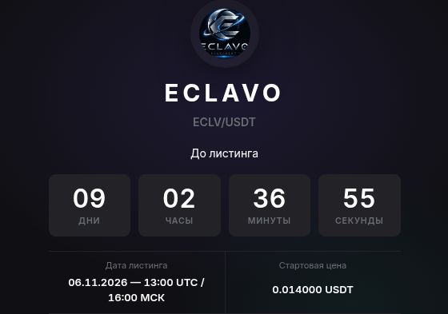
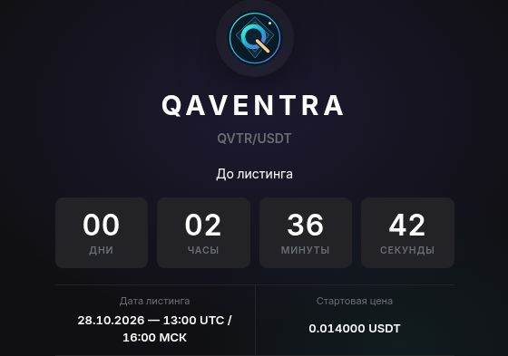
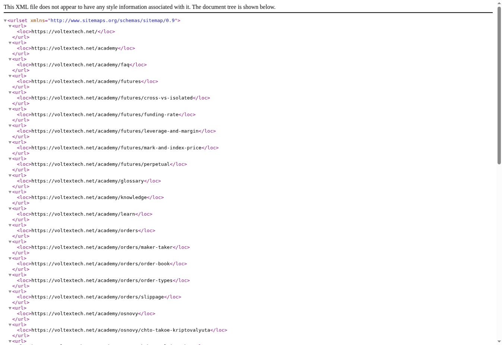
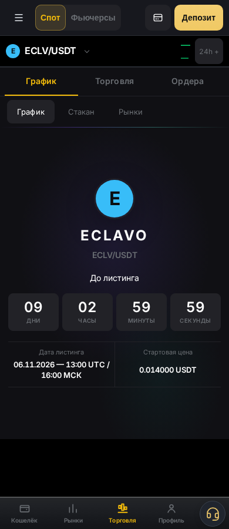
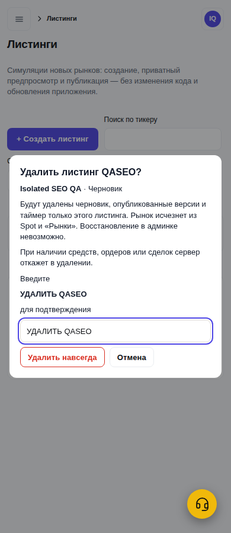

# Issue #632 — production SEO published and verified

**Actual Pages source:** `6118e18e49edd226a6b250154d3893773b4522e2`.
**Deployment:** `95010b1c-b13f-4c52-b08c-a90ffa7d5d60`, SUCCESS at **2026-10-28 10:18:33 UTC / 12:18:33 Kyiv**.
Base/rollback: `f8805b0073d17c3072f37803cb7efbce538ab170`, deployment `ec6734c9-6c1e-4985-8d57-023edc505e9d` retained successful. No rollback needed.

This is the merged #634 SEO delta over actual deployed f880, **not raw main**. Existing operator branch reused, no new PR or merge. API, Worker, PostgreSQL, financial configuration, listings and timers were not changed by this release.

## Source and publication evidence

- Candidate directly descends from f880; reviewed frontend tree `82c6cd48743fbcf89f30cbbbb31ba2de33feaef7`.
- Ten relevant runtime files byte-identical to f880, including Banking/API, Admin Delete/API, movement editor/model, terminal, managed market store, NRX presentation guard and referral destinations. App.tsx adds only the SEO head component; original cache rules preserved.
- [Exact candidate Ubuntu QA](https://github.com/nazardzuba79-tech/-/actions/runs/40669960893): Node22.23.3 build PASS, **11 suites / 220 tests / zero skipped**, **114 SEO checks**, **18 isolated browser compatibility cases** at1440/390 PASS. Overall job FAILED only at publication because the existing `CLOUDFLARE_PAGES_TOKEN` secret was empty. That attempt made no Cloudflare write; it is not described as an overall green run.
- Actual publication used the already-authorized Cloudflare Git source. Production source branch was temporarily selected as the held exact candidate branch, one explicit production Git build requested, then source settings restored to main immediately. Auto-deploy stayed OFF, previews NONE, production environment unchanged throughout.
- Provider clone log explicitly records `HEAD is now at 6118e18`; native build Node22.23.4, `Parsed 24 valid header rules`, 338 assets uploaded/reused, deployment SUCCESS. No broad main build, no Pages Functions.
- Final provider readback: both production-branch fields main; canonical source6118; autoOFF/previewsNONE; exact original three public VITE values; previous successful deployment available. See [pages-production.json](pages-production.json).
- Temporary branch workflow triggers are removed in the evidence/cleanup commit; original manual/main-only workflow restored byte-for-byte. Main's workflow was never edited. The cleanup HEAD is evidence, not the deployed source.

## Real production HTTP checks

[Read-only live verification run](https://github.com/nazardzuba79-tech/-/actions/runs/40671305906): SUCCESS. The verifier reproduced the exact frontend/shared source tree, with no Cloudflare credential or deployment operation.

| Actual request/check | Result |
| --- | --- |
| robots.txt | HTTP200, `text/plain; charset=utf-8`, exact expected bytes |
| sitemap.xml | HTTP200, `application/xml`, exact expected bytes,42 URLs |
| All42 public canonical URLs | HTTP200, own canonical, no noindex |
| Banking, Admin Listings, ECLV/QVTR/NRX trade deep links | HTTP200 shell, noindex meta/header, no canonical |
| Published entry `/assets/index-DGXlUZ5S.js` | exact byte/hash match to source build |
| Entry SHA256 | `62d2f4cc22dbbcd596175b8ca137053832eec2ec7f682d67b35e1ae9c7dfcffe` |

**47/47 checked pages PASS** at10:21:17UTC /12:21:17Kyiv. Full raw receipt: [live-http.json](live-http.json). Saved [robots.txt](robots.txt) and [sitemap.xml](sitemap.xml) hashes match actual HTTP bytes.

## Authenticated real-site read-only browser checks

- ECLAVO: approved PNG loaded; native countdown present and ticking; date06.11.2026 13:00UTC/16:00MSK and initial0.014000USDT unchanged. No publish/timer operation.
- QAVENTRA: approved logo loaded; native countdown present; date28.10.2026 13:00UTC/16:00MSK and initial0.014000USDT unchanged.
- NRX/BTC: removed-market notice, zero inputs and canvases; noindex/no canonical. All five NRX URL variants also covered in both isolated browser viewports.
- Banking: actual authenticated page and referral block/link present, new entry loaded, noindex/no canonical. No personal referral code, balance or email captured here; no placement/financial request made.
- Admin Delete: actual ECLV/QVTR records still present; ECLV dialog opens; wrong confirmation keeps irreversible button disabled; Cancel closes it and preserves both listings. **No real deletion submitted.** Complete synthetic delete/receipt path passed at1440/390 in the isolated bundle test.
- `https://ru.voltextech.net/academy/faq`: actual page canonical and og:url are `https://voltextech.net/academy/faq`; new entryDGXlUZ5S loaded. This is not a Russian-ISP/no-VPN test.
- Live browser readback also confirms robots text/plain and valid XML/42loc/no private/query URL in sitemap. Public Academy wallets-seed article correctly remains eligible.

[Public-only browser observations](live-ui.json). Actual live browser viewport was1363px;1440/390 claims refer to the real-bundle isolated QA, not a fabricated mobile production session.

The mobile images below are explicitly isolated fixtures, not production accounts or deletion. The ECLV fixture has no production logo payload; the actual approved PNG is shown above and was not changed.

## Rollback and remaining boundaries

Rollback remains POST to the previous successful Pages deployment's rollback endpoint, then provider SHA readback and public-route smoke checks. No DB restore or API rollback is involved. Only perform it if the expected current candidate still owns canonical production; do not overwrite another operator's newer release.

No API/Worker/DB/TLS/DNS/secrets/balance/financial-flag change. No real order, transfer, withdrawal, listing deletion or timer restart. No Stocks or Wallet Conversion activation. Google/Yandex property ownership, sitemap submission and actual search indexing have not been verified; publication is not an indexing claim.

QA artifact SHA256 `d0c6df8de92222810e36de502e6eec7fcc95da040c10242989b88408081c35bb`; live receipt artifact SHA256 `82b1330c72d14f1dbf1d72e36fba01187681752518758be654e60ff9fb81c22e`. Durable test counts and scope: [tests.json](tests.json).
